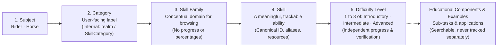
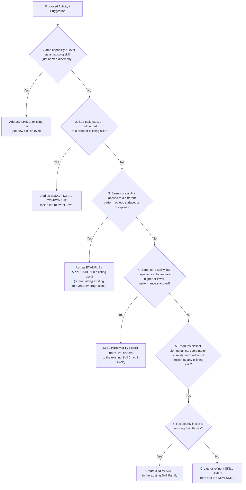

# Horse and Rider's Companion — Skill Tree Curriculum Guide

> **Purpose & Status:** Permanent architectural, pedagogical, and editorial reference for the Skill Tree curriculum (`curriculum/v2/`). This guide governs how skills, difficulty levels, components, and Skill Families are organized, authored, reviewed, and maintained by human trainers, administrators, and AI development agents.

---

## 1. Guiding Philosophy

### Track Meaningful Abilities at Progressive Levels, Not Individual Tasks

The Horse and Rider's Companion Skill Tree is an **open, approachable educational framework and capability profile**. Its purpose is to help riders, horse owners, and trainers understand:
1. **What a rider or horse is capable of doing**,
2. **How developed and reliable those abilities are** (`Learning`, `Proficient`, `Instructor Verified` across `Introductory`, `Intermediate`, and `Advanced` standards), and
3. **How foundational abilities connect to further development** across horsemanship traditions.

### Core Tenets
- **Capabilities Over Checklists:** The Skill Tree must never become an exhaustive checklist of every chore, tool, arena figure, or obstacle a person might encounter around horses. A skill represents a coherent, transferable horsemanship capability (e.g., *Grooming*, *Steering & Navigation*, *Terrain & Obstacle Negotiation*, *Object Handling*). Individual sub-tasks, tools, or patterns (e.g., picking hooves, riding a figure-eight, crossing a tarp) belong inside a skill as **educational components or examples**, not as separate checkable skills.
- **Deliberately Incomplete & Built to Grow:** The initial curriculum (31 Skill Families, 57 Skills, 104 Difficulty Standards) is intentionally a foundational baseline—not a closed syllabus. Future growth through trainer authorship and community suggestions is expected and encouraged, provided new additions follow the classification rules in Section 3.
- **Discovery Without Completion Pressure:** The Skill Tree does not use global or per-family completion percentages (`X% complete`). Expanding the curriculum to serve advanced or specialized riders must never penalize recreational riders or make existing users appear less accomplished.
- **Suggestions, Never Locks:** Foundational relationships (`foundation`, `next`, `counterpart`, `theory`) guide learning and discovery; they never lock skills or restrict a rider, horse owner, or instructor from recording progress at any level.

---

## 2. Curriculum Organization

### 2.1 The Five-Layer Hierarchy

The curriculum follows a strict five-layer hierarchy (with educational components attached inside each difficulty level):



| Layer | User-Facing Term | Internal / Schema Identifier | Purpose & Boundary | Tracks Progress? |
| :--- | :--- | :--- | :--- | :--- |
| **1. Subject** | **Rider** or **Horse** | `subject`: `"rider"` \| `"horse"`<br>Profile context (`isForRider`) | Derived automatically from the profile being viewed. Separates human competencies from equine competencies. | No |
| **2. Category** | **Category** | JSON/Firestore: `realm`<br>Dart enum: `SkillCategory` | Top-level domain within a Subject:<br>• **Rider Categories (4):** `Husbandry`, `In-Hand` (`In_Hand`), `Mounted`, `Theory & Knowledge` (`Other`)<br>• **Horse Categories (2):** `In-Hand` (`In_Hand`), `Mounted` | No |
| **3. Skill Family** | **Skill Family** | Collection: `SkillFamilies`<br>Field: `familyId` | Groups skills that share a clear functional or biomechanical theme for collapsible browsing. Never tracks completion or percentages. | **No** |
| **4. Skill** | **Skill** | Collection: `SkillsV2`<br>Field: `id` (`<subject>.<realm>.<slug>`) | A single meaningful, standalone ability that a rider, owner, or trainer would reasonably assess as a capability on a profile. | Container only |
| **5. Difficulty Level** | **Level** (`Introductory`, `Intermediate`, `Advanced`) | `availableLevels[]` & `levels.<level>`<br>Dart enum: `DifficultyState` | A substantively distinct performance standard within a Skill. Only levels with meaningfully different observable criteria are offered (1, 2, or 3 levels). | **Yes** (`Learning`, `Proficient`, `Verified`) |
| *(Sub-layer)* | **What This Level Includes** (Components) | `levels.<level>.components[]` (`{title, description}`) | Named sub-tasks, knowledge items, or representative applications within a level. Indexed for search; never checked off individually. | **No** |

> [!IMPORTANT]
> **Terminology Rule (`Category` vs. `realm`):** Always use **"Category"** in user-facing UI labels, headings, filter chips, empty states, and accessibility text. Preserve `"realm"` in `curriculum/v2/*.json`, Firestore documents (`SkillFamilies`, `SkillsV2`), and `SkillCategory` (`Husbandry`, `In_Hand`, `Mounted`, `Other`) in internal Dart/backend code.

### 2.2 Category Boundaries

1. **Rider → Husbandry (`Husbandry`):** Rider-only. Covers human responsibility for physical care, barn safety, grooming, blanketing, health monitoring, first aid, medications, leg protection, nutrition, stall/pasture upkeep, and tack selection/fit/maintenance.
2. **Rider → In-Hand (`In_Hand`):** Human groundwork skills performed from the ground: catching, haltering, leading, yielding the horse's body in-hand, longeing, ground driving/long-lining, negotiating obstacles in-hand, and loading/unloading a trailer.
3. **Rider → Mounted (`Mounted`):** Human riding skills under saddle: mounting/dismounting, position/balance, gaits, transitions, rebalancing, steering/navigation, pivots/body control, lateral work, terrain/obstacle negotiation, and mounted object handling.
4. **Rider → Theory & Knowledge (`Other`):** Rider-only. Conceptual understanding of equine learning theory, ethology/body language, biomechanics/training principles, and equine welfare/ownership ethics.
5. **Horse → In-Hand (`In_Hand`):** The horse's learned manners, confidence, and responsiveness on the ground—including leading, standing tied/quietly, cooperative behavior during daily/hoof/veterinary care (*Handling & Care*), travel/environmental composure, and work on the line. *(Horses do not have a separate Husbandry category; their cooperative care behaviors live here.)*
6. **Horse → Mounted (`Mounted`):** The horse's learned balance, responsiveness, confidence, and self-carriage under saddle.

### 2.3 Organizational Principles for Skill Families

Skill Families exist to give riders and trainers a predictable mental map when browsing a Category. To ensure future skills can be added without repeatedly restructuring the curriculum:

1. **Define Families by Functional Domain, Not by Skill Count:**
   - A Skill Family represents a coherent functional or biomechanical domain (e.g., *Tack & Equipment*, *Lateral Movements*, *Work on the Line*, *Object Handling*).
   - **Single-skill families are completely acceptable** when the domain is genuinely distinct and likely to be looked for as a top-level heading (or expanded in the future). Never merge unrelated domains just to avoid a 1-skill family, and never split a unified skill into fragments just to make a family look fuller.
   - Likewise, **empty families in developing categories** (such as the four *Theory & Knowledge* families) are valid structural placeholders; never invent filler skills solely to populate an empty family.
2. **Mutually Exclusive, Clearly Stated Boundaries:**
   - Every Skill Family must have a one-sentence `description` that makes it obvious which skills belong inside it and which belong in neighboring families.
   - **Example — Mounted Body Control vs. Lateral Movements:**
     - **Pivots & Body Control** (`*.mounted.pivots_body_control`) covers *stationary, backward, or purely sideways (90°) repositioning* (`Turn on the Forehand`, `Turn on the Haunches`, `Rein Back`, `Sidepass`, and future `Walk Pirouette` or `Western Spin`).
     - **Lateral Movements** (`*.mounted.lateral_movements`) covers *moving simultaneously forward and sideways along a line or diagonal with controlled alignment/bend* (`Leg Yield`, `Shoulder-In`, `Travers`, and future `Renvers` or `Half-Pass`).
   - **Example — Mounted Steering vs. Terrain/Obstacles vs. Object Handling:**
     - **Steering, Bend & Direction Changes** covers *controlling the path of travel, geometry, bend, and route planning* (straight lines, circles, serpentines, cone/marker patterns, slaloms, pole bending).
     - **Terrain & Obstacles** covers *negotiating physical surfaces, footing changes, and crossing/jumping obstacles* (poles, cavaletti, bridges, tarps, water crossings, banks, slopes).
     - **Object Handling** covers *manipulating, carrying, or interacting with an external object or latch while mounted* (gates, mail, bells, ropes, rings, garrocha).
3. **Stable Ordering via `sortOrder`:**
   - Families within a Category and skills within a Family use integer `sortOrder` increments of `10` (`10, 20, 30...`) from foundational/everyday to specialized, allowing new skills or families to be inserted cleanly (e.g., at `15` or `25`) without renumbering the entire curriculum.

---

## 3. Classifying New Suggestions

Whenever a trainer, administrator, or community member proposes a newhorsemanship activity, apply the **Six-Way Classification Decision Tree** below in order.

### 3.1 Decision Flowchart



### 3.2 The Six Classification Outcomes & Practical Horsemanship Examples

| Classification | Decision Criteria | Practical Horsemanship Examples |
| :--- | :--- | :--- |
| **1. Already Covered (Add Alias Only)** | The proposed item is a discipline-specific, regional, or classical synonym for an ability and standard already described in the Skill Tree. | • *"Lope"* or *"Lope depart"* → Alias on `Canter`<br>• *"Jog"* or *"Rising trot"* → Alias on `Trot`<br>• *"Disengage the hindquarters"* → Alias on `Turn on the Forehand`<br>• *"Épaule en dedans"* / *"Shoulder-fore"* → Alias on `Shoulder-In`<br>• *"Long-reining"* / *"Double-lunging"* → Alias on `Ground Driving` |
| **2. Educational Component** | It is a step, tool, check, or sub-task normally performed as part of a broader ability, and tracking it as a separate skill would create checklist bloat without changing a trainer's overall judgment. | • *"Pick hooves"* or *"Brush mane and tail"* → Component of `Grooming (Introductory)`<br>• *"Bathing a horse"* → Component of `Grooming (Intermediate)`<br>• *"Tie a quick-release knot"* → Component of `Safe Handling & Restraint (Introductory)`<br>• *"Check girth/cinch before mounting"* → Component of `Mounting & Dismounting` and `Tack Use, Fit & Care`<br>• *"Take temperature/pulse/respiration"* → Component of `Health Monitoring (Intermediate)` |
| **3. Variation / Application of an Existing Skill** | It applies the *same underlying coordination and biomechanics* to a different arena pattern, marker layout, obstacle surface, or object. | • *"Pole bending"*, *"Cloverleaf barrels"*, *"Figure-eight"*, *"Serpentine"* → Applications of `Steering & Navigation` (`Intro` at walk, `Int` at trot, `Adv` at canter)<br>• *"Ride over a tarp"* vs. *"Ride across a wooden bridge"* → Applications of `Terrain & Obstacle Negotiation`<br>• *"Back through an L"* → Application of `Rein Back (Intermediate)`<br>• *"Sidepass over a ground pole"* → Application of `Sidepass (Intermediate)`<br>• *"Carry a flag/mail"* or *"Spear a ring"* → Applications of `Object Handling` |
| **4. Additional Difficulty Level on an Existing Skill** | It represents a genuine, observable step down (entry point) or step up (refinement/complexity) of an existing skill that currently offers fewer than three levels. | • Adding `Introductory` (basic wound recognition & calling the vet) below `First Aid (Intermediate)`<br>• Separating `Shoulder-In` into `Intermediate` (walk shoulder-fore/shoulder-in) and `Advanced` (sustained trot shoulder-in along a full long side)<br>• Adding `Advanced` (ground-tying) above `Standing Quietly` (`Intro` tied in familiar spot, `Int` tied in busy venues) |
| **5. Genuinely Distinct New Skill** | It requires **new biomechanics, spinal bend/footfall mechanics, independent rider coordination, or specialized safety knowledge** not implied by any existing skill, AND a trainer/rider would meaningfully ask *"Can this rider/horse do X?"* | • `Half-Pass (Appuyer)` vs. `Shoulder-In` or `Leg Yield`<br>• `Flying Lead Changes` vs. `Canter`<br>• `Jumping / Over Fences` vs. `Terrain & Obstacle Negotiation`<br>• `Walk/Canter Pirouette` or `Western Spin` vs. `Turn on the Haunches`<br>• `Equine Learning Theory (R- & R+)` in *Theory & Knowledge* |
| **6. Skill Family Reorganization or Addition** | Multiple distinct skills emerge that blur an existing family's boundary or open a new domain not represented by current families. | • Clarifying `Horse → In-Hand → Travel & New Environments` so its boundary explicitly encompasses both transport (`Trailer Loading`) and unfamiliar ground obstacles/outings.<br>• Adding a future `Jumping & Over Fences` family under `Mounted` if multiple jumping skills are introduced. |

### 3.3 Worked Case Studies

#### Case Study A: Why "Pole Bending" Does Not Require a Separate Skill
When a rider weaves through six upright poles at walk, trot, or canter:
- **What is the underlying human & equine capability?** Looking ahead, planning a curved path around markers, coordinating bend changes from left to right, maintaining rhythm, and managing leads/balance at canter.
- **Where does that capability already live?** `Steering & Navigation` (`rider.mounted.steering_navigation` and `horse.mounted.steering_navigation`) explicitly covers guiding a horse along straight lines, circles, serpentines, slaloms, and marker patterns at walk (`Introductory`), trot (`Intermediate`), and canter (`Advanced`).
- **Why not make Pole Bending its own skill?** If Pole Bending were a separate skill, then Barrel Cloverleaf, Cone Serpentine, Figure-Eight Around Markers, and Keyhole Pattern would also demand separate skills—turning the Skill Tree into a game-by-game rulebook. Instead, `"Pole bending"` and `"Slalom"` are indexed as searchable **aliases/examples** of `Steering & Navigation`, while competition speed remains outside the foundational curriculum.

#### Case Study B: Why "Shoulder-In" and "Half-Pass" Warrant Separate Skills
Compare `Leg Yield`, `Shoulder-In`, and `Half-Pass`:
- In **Leg Yield** (`Intermediate`), the horse moves forward and sideways with a straight body or slight flexion *away* from the direction of travel.
- In **Shoulder-In** (`Intermediate` at walk / `Advanced` at trot), the horse is bent slightly *away* from the direction of travel while moving along a straight track on three tracks, flexing and engaging the inside hind leg under the center of mass.
- In **Half-Pass (*Appuyer*)** (`Advanced`), the horse is bent *into* the direction of travel while moving simultaneously forward and sideways across a diagonal, requiring outside-leg impulsion combined with inside bend and collection.
- **Why separate skills?** Proficiency in `Shoulder-In` does not imply proficiency in `Half-Pass`; the spinal bend relative to travel, the coordination of inside/outside aids, and the biomechanical load on the hindquarters are fundamentally different. Thus they pass Test #5 as distinct skills within the `Lateral Movements` family.

---

## 4. Difficulty and Proficiency

### 4.1 Two Orthogonal Dimensions

The Skill Tree strictly separates **what standard is being attempted** (Difficulty Level) from **how well the rider or horse currently performs that standard** (Proficiency State):

| Dimension | Values | Who Controls It | Meaning |
| :--- | :--- | :--- | :--- |
| **Difficulty Level**<br>*(Curriculum Definition)* | • `Introductory`<br>• `Intermediate`<br>• `Advanced` | **Curriculum** (`SkillsV2.availableLevels` & `levels`) | Defines the technical complexity, precision, balance, and environmental demand of the standard. |
| **Self-Assessed Proficiency**<br>*(User Progress per Level)* | • *Not Started* (no entry)<br>• `Learning`<br>• `Proficient` | **Rider** (for self) or **Horse Owner** (for horse) | The learner's or owner's honest current assessment at that specific Difficulty Level. |
| **Instructor Verification**<br>*(Independent Layer per Level)* | • `Verified` (`PROFICIENT`) | **Connected Active Instructor** (via Cloud Functions only) | Formal attestation by an authorized instructor that the rider or horse has demonstrated the `Proficient` standard for that specific `(skill, level)`. |

### 4.2 Definitions of Difficulty Levels

- **`Introductory`:** Basic understanding and safe, functional execution in familiar, low-stress settings (and on a cooperative, prepared horse for Rider skills). Polish, collection, and tight precision are not required. Allows learners and green horses to experience core movements early with achievable standards.
- **`Intermediate`:** Greater precision, consistency, accuracy, balance, timing, and refinement—or calm, reliable execution across moderately varied environments, patterns, or gaits.
- **`Advanced`:** Technically complex work requiring sophisticated coordination, engagement, collection, subtle multi-aid feel, or sound judgment across demanding sequences and environments.

### 4.3 Definitions of Proficiency & Verification States

- **`Learning`:** The rider or horse is actively practicing this level's standard—often with coaching, reminders, a helper, or intermittent loss of rhythm, angle, or consistency—while maintaining basic safety.
- **`Proficient`:** The rider or horse **independently, safely, and reliably** meets the observable criteria for that level in both directions (where applicable) without force or unsafe shortcuts.
- **`Instructor Verified`:** An active connected instructor has observed and confirmed `Proficient` execution at that specific level. Verification is stored in an independent backend-protected document (`SkillVerifications`) and never overwrites the learner's underlying self-assessment.

### 4.4 Independence of Difficulty Levels Within a Skill

1. **Per-Level Independence:** Every available level on a skill has its own independent progress state. Recording, changing, or clearing one level **never** auto-fills, promotes, demotes, or revokes another level.
2. **Simultaneous Multi-Level States:** A rider can be **`Proficient` (and `Instructor Verified`) at `Introductory` Grooming** while simultaneously being **`Learning` at `Intermediate` Grooming**. Both states coexist and are displayed clearly on level chips and in *My Skills*.
3. **No Mandatory Three-Level Padding:** A skill offers **1, 2, or 3 levels** (`availableLevels`). A level exists **only** if its observable criteria differ from neighboring levels in substance—never merely by swapping adjectives (*"good"* → *"very good"* → *"excellent"*). Skills may start at any level:
   - `Mounting & Dismounting` offers only `["introductory"]`.
   - `Leg Yield` offers only `["intermediate"]`.
   - `Shoulder-In` offers `["intermediate", "advanced"]`.
   - `Travers (Haunches-In)` offers only `["advanced"]`.
   - `Steering & Navigation` offers `["introductory", "intermediate", "advanced"]`.

### 4.5 How Gait, Precision, Complexity, and Safety Influence Difficulty (Without Universal Gait Rules)

While gait progression (`Walk` → `Trot` → `Canter`) is a natural separator for multi-gait skills like `Steering & Navigation` and `Terrain & Obstacle Negotiation`, **there is no universal rule that Introductory = Walk, Intermediate = Trot, and Advanced = Canter**:
- **Core Gaits Start at Introductory:** `Walk`, `Trot`, and `Canter` all have `Introductory` levels so beginners can learn safe, functional balance at all three gaits before refining diagonals (`Trot Intermediate`) or lead selection and 20 m circles (`Canter Intermediate`).
- **Stationary/Walk Skills Can Span Multiple Levels:** `Turn on the Forehand` and `Turn on the Haunches` take place at halt/walk across both `Introductory` (generous arc / 90–180°) and `Intermediate` (compact ~1 m arc / 180–360° with seamless walk transitions).
- **Safety Always Supersedes Speed:** In `Object Handling` and `Terrain & Obstacle Negotiation`, fixed latch gates, narrow bridges, and slick surfaces are **always** negotiated at halt or walk regardless of whether the rider is working at `Introductory`, `Intermediate`, or `Advanced`. At `Advanced`, part of the proficiency standard is **sound judgment on when to slow down**.

---

## 5. Rider and Horse Separation

### 5.1 Independent Assessment Philosophy

A horse-and-rider partnership consists of two distinct learners whose abilities develop at different rates:
- A novice rider (`Introductory Learning` at `Turn on the Forehand`) may ride a seasoned schoolmaster (`Intermediate Proficient` at `Turn on the Forehand (Under Saddle)`).
- An experienced trainer (`Advanced Proficient` at `Ground Driving`) may be introducing long lines to a green horse (`Introductory Learning` at `Ground Driving`).

Therefore, Rider progress lives exclusively under `Rider_Profile/{id}/SkillProgress` and Horse progress lives exclusively under `Horse_Profile/{id}/SkillProgress`.

### 5.2 What Rider Skills vs. Horse Skills Evaluate

| Dimension | Rider Skills (`subject: "rider"`) | Horse Skills (`subject: "horse"`) |
| :--- | :--- | :--- |
| **Who is being evaluated?** | **Only the human** (rider or handler). | **Only the horse.** |
| **Assumed partner baseline** | Assumes a **cooperative, reasonably prepared horse** (unless the skill explicitly addresses managing mild tension at a higher level). Teaching an untrained or fearful horse a new behavior from scratch is a separate trainer competency and must not be required for Rider proficiency. | Assumes a **handler or rider giving clear, fair, timely requests** in a safe setting. |
| **Observable criteria to grade** | • Human posture, seat, balance, and independent hands<br>• Preparation, look-ahead, and arena/spatial planning<br>• Timing, clarity, and prompt release of aids<br>• Safe positioning, equipment checks, and judgment | • Willingness, relaxation, and emotional composure<br>• Softness and responsiveness to light halter, leg, seat, or rein cues<br>• Physical balance, rhythm, straightness, and bend<br>• Patience when standing, tied, or being handled |
| **What must NEVER be graded** | Do **not** fail a rider because the horse is green, stiff, or uncooperative; avoid clauses like *"the horse never drifts"* without framing them around the rider's guiding aids on a prepared horse. | Do **not** grade the horse on human tasks such as memorizing arena geometry, planning a cone course, checking girth tightness, or tying a knot. |

### 5.3 Asymmetric Levels & Non-Mandatory Counterparts

1. **Counterpart Levels Need Not Match:**
   - When a Rider skill and a Horse skill are linked via `{"skillId": "...", "relation": "counterpart"}`, their `availableLevels` do **not** need to be identical.
   - *Canonical Example:* `horse.in_hand.ground_driving` offers `["introductory", "intermediate"]` (a green horse learning to accept lines and walk/trot calmly), whereas `rider.in_hand.ground_driving` offers `["intermediate", "advanced"]` (handling two long lines safely from behind a horse is never an `Introductory` human skill).
2. **Never Create Counterparts Merely for Structural Symmetry:**
   - Only create a skill if it represents a meaningful, observable ability for that specific subject.
   - *Rider-Only Skills:* All `Husbandry` skills (`Feeding`, `Stable Care`, `First Aid`, `Administering Medications`, `Leg Wraps`, `Tack Use, Fit & Care`), all `Theory & Knowledge` skills, and `Half-Halt (Rebalancing)` (whose equine counterpart is embedded as a component inside `horse.mounted.transitions`).
   - *Consolidated Horse Skills:* Three separate Rider Husbandry skills (`Grooming`, `Blanketing`, `Tack Use, Fit & Care`) map to a single Horse In-Hand counterpart (`horse.in_hand.daily_care_handling` — *Daily Care Handling*), because from the horse's perspective, standing calmly for brushes, blankets, and saddles is one unified cooperative behavior.

---

## 6. Curriculum Writing Standards

### 6.1 Editorial Rules for Every Skill Field

1. **Skill ID (`id`):**
   - Format: `<subject>.<realm_snake_case>.<concise_slug>` (e.g., `rider.mounted.shoulder_in`, `horse.in_hand.standing_quietly`).
   - Once published, a skill ID is **immutable forever**.
2. **Skill Name (`name`):**
   - Plain, widely understood horsemanship English (2–5 words).
   - For Horse skills whose name would otherwise be identical to a Rider skill, append `(Under Saddle)` or `(In-Hand)` where helpful for clarity in search and logs (e.g., `Walk (Under Saddle)`).
3. **Summary (`summary`):**
   - One sentence (15–30 words) stating **what the ability is**.
   - For Rider skills, begin with an active human verb (*"Guiding a reasonably prepared horse..."*, *"Safely checking tack, mounting..."*).
   - For Horse skills, begin with *"The horse's ability to..."* or *"The horse's calm cooperation..."*.
4. **Educational Purpose (`purpose`):**
   - One sentence explaining **why the skill matters** for horse welfare, safety, biomechanics, or practical horsemanship.
5. **Safety Guidance (`safety[]`):**
   - 1 to 3 concise, actionable imperatives focusing on physical safety, equine welfare, footing/environment checks, and avoiding force.
6. **Level Overview (`levels.<level>.overview`):**
   - One sentence summarizing the scope and context of that specific difficulty level.
7. **Educational Components (`levels.<level>.components[]`):**
   - 1 to 4 `{ "title": "...", "description": "..." }` items naming specific sub-tasks, checks, or representative applications included in that level.
   - Component titles are indexed by search so users searching for a sub-task (e.g., *"pick hooves"*, *"halt on a mark"*, *"tarp"*) land directly on the parent skill.
8. **Learning Description (`levels.<level>.learning`):**
   - One sentence describing normal, safe, developing practice at that level (e.g., working with coaching, occasional loss of rhythm/alignment, or needing a reset). Should normalize the learning process without describing reckless or abusive behavior.
9. **Proficient Description (`levels.<level>.proficient`):**
   - One to two sentences stating observable, verifiable criteria for independent competence.
   - For Rider skills, typically begins with *"Independently..."* and evaluates human preparation, balance, aid coordination, and safety.
   - For Horse skills, evaluates calm, willing, balanced execution in response to light cues.
   - Whenever an `Introductory` level intentionally omits a refinement that trainers might otherwise assume (such as correct canter lead selection in `Canter Introductory`, or trot execution in `Shoulder-In Intermediate`), state that boundary explicitly (e.g., *"Correct lead selection is not required at this level."*).
10. **Aliases (`aliases[]`):**
    - Include cross-discipline synonyms (Classical/French, Western/Ranch, Working Equitation, UK/Commonwealth, Natural Horsemanship) and common task phrases so search works regardless of a user's background.
11. **Related Skills (`relatedSkills[]`):**
    - Allowed `relation` values:
      - `"counterpart"`: Links a Rider skill and a Horse skill (`subject` must be opposite, and the target skill must contain the symmetric `"counterpart"` link back).
      - `"foundation"`: Soft, non-blocking "Suggested Building Block" (`level` optional; must form a Directed Acyclic Graph with **zero cycles**).
      - `"next"`: Suggested follow-up skill to explore next.
      - `"theory"`: Links a practical skill to a relevant `Theory & Knowledge` skill.
12. **Technique Neutrality (Mandatory):**
    - Describe **what** successful communication, biomechanics, and safety look like—never prescribe a single trainer's proprietary method, bit/bridle/halter type, pressure-escalation count, or reinforcement quadrant as the only way to be `Proficient`. Specific instructional methods belong in linked **Resources**.

### 6.2 Reusable JSON Template for Future Skills

```json
{
  "id": "<subject>.<realm_lower>.<skill_slug>",
  "schemaVersion": 2,
  "status": "active",
  "subject": "rider",
  "realm": "Mounted",
  "familyId": "rider.mounted.<family_slug>",
  "name": "Human-Readable Skill Name",
  "aliases": [
    "Cross-discipline synonym",
    "Common task phrase"
  ],
  "summary": "One-sentence definition of what the skill is, framed for the subject (rider or horse).",
  "purpose": "One-sentence explanation of why this ability matters for safety, welfare, or progression.",
  "safety": [
    "Actionable safety or welfare guardrail specific to this skill."
  ],
  "availableLevels": ["introductory", "intermediate"],
  "levels": {
    "introductory": {
      "overview": "Concise summary of the Introductory standard and context.",
      "components": [
        {
          "title": "Searchable Sub-Task or Component Name",
          "description": "What this sub-task or application entails."
        }
      ],
      "learning": "Observable description of normal, safe developing practice at Introductory.",
      "proficient": "Independently performs the Introductory standard with safe, functional execution.",
      "standardVersion": 1
    },
    "intermediate": {
      "overview": "Concise summary of the Intermediate standard (greater precision, balance, or context).",
      "components": [
        {
          "title": "Refined Component or Application",
          "description": "Description of the Intermediate component."
        }
      ],
      "learning": "Observable description of developing practice at Intermediate.",
      "proficient": "Independently performs the Intermediate standard with consistency, balance, and refinement.",
      "standardVersion": 1
    }
  },
  "relatedSkills": [
    { "skillId": "horse.mounted.<counterpart_slug>", "relation": "counterpart" },
    { "skillId": "rider.mounted.<foundation_slug>", "relation": "foundation", "level": "introductory" },
    { "skillId": "rider.mounted.<next_slug>", "relation": "next" }
  ],
  "legacyIds": [],
  "sortOrder": 10
}
```

---

## 7. Community Contributions (Design Specification)

> [!NOTE]
> **Design Specification Only:** The community must **never** directly edit the canonical `SkillsV2` or `SkillFamilies` collections. This section defines the editorial and administrative workflow for handling future user-submitted curriculum suggestions.

### 7.1 Suggested Contribution Categories

When a user or instructor submits a suggestion, they select a **Contribution Category** so they are not prompted to invent a brand-new skill when a smaller refinement fits better:
1. **`missing_term_or_alias`** — *"I call an existing skill by a different name or discipline term"*
2. **`component_or_example`** — *"A useful sub-task, obstacle, or exercise should be mentioned inside an existing skill"*
3. **`level_adjustment_or_addition`** — *"An existing skill needs an Introductory, Intermediate, or Advanced standard (or clearer criteria)"*
4. **`new_skill_proposal`** — *"A distinct horsemanship ability is missing from the Skill Tree"*
5. **`safety_or_wording_correction`** — *"A safety note or description could be clearer, more accurate, or more technique-neutral"*

### 7.2 Seven-Step Administrator Review Workflow


1. **Receive Suggestion:** Capture submitter identity, role (rider, horse owner, instructor), contribution category, proposed title/description, suggested Subject (`Rider` or `Horse`) and Category (`Husbandry`, `In-Hand`, `Mounted`, `Theory & Knowledge`), and rationale.
2. **Identify the Relevant Subject, Category, and Existing Skill:** Search `curriculum/v2/*.json` across `name`, `aliases`, and `components.title` to locate overlapping or neighboring skills and families.
3. **Evaluate Whether the Suggestion Is Already Covered:** Apply the **Section 3 Classification Decision Tree** (`Already Covered` → `Component` → `Variation/Application` → `Difficulty Level` → `New Skill` → `Family Adjustment`).
4. **Determine the Minimum Appropriate Curriculum Action:**
   - Prefer adding an **alias** or **component/example** over creating a new skill whenever the underlying capability is already tracked.
   - Prefer adding a **difficulty level** to an existing 1- or 2-level skill over creating a duplicate skill for a harder gait or environment.
   - Create a **new skill** only when all Section 3 criteria for a distinct capability are met.
5. **Review Educational Accuracy, Subject Separation, and Safety:**
   - Verify that Rider criteria evaluate the human (on a prepared horse) and Horse criteria evaluate the horse.
   - Verify technique neutrality (no single trainer dogma or mandatory equipment).
   - Ensure explicit safety guardrails are included.
6. **Assign Review Status (`Approve`, `Request Clarification`, or `Decline`):** Record a brief administrator note explaining how the suggestion was integrated (e.g., *"Added 'Pole bending' as an alias and Advanced pattern example under Steering & Navigation"*).
7. **Validate and Publish Approved Changes:** Edit the version-controlled `curriculum/v2/*.json` files, run `node tool/validate_curriculum_v2.js` and `flutter test test/domain/curriculum_v2_validation_test.dart`, and publish via the Admin SDK publication pipeline.

### 7.3 Administrator Review Statuses

| Status | Meaning |
| :--- | :--- |
| `submitted` | Received and awaiting initial triage. |
| `under_review` | Assigned to a trainer/administrator for curriculum evaluation. |
| `needs_clarification` | Returned to submitter with a question about scope, safety, or terminology. |
| `approved_as_alias_or_component` | Accepted and integrated into an existing skill's `aliases[]` or `components[]` (no new skill ID needed). |
| `approved_as_level` | Accepted as a new `Introductory`, `Intermediate`, or `Advanced` level on an existing skill. |
| `approved_as_new_skill` | Accepted as a new canonical skill in `curriculum/v2/skills_*.json`. |
| `published` | Validated and deployed to production `SkillsV2` / `SkillFamilies`. |
| `declined_already_covered` | Already represented in the curriculum; submitter pointed to the existing skill/level. |
| `declined_out_of_scope` | Too granular (individual chore/task), unsafe, or dogmatic. |

---

## 8. Curriculum Maintenance and Stability

Evolving the curriculum over years must **never** corrupt or silently invalidate a rider's or horse's established progress, instructor verifications, or educational resources.

### 8.1 Stable Skill Identifiers
- **Immutable IDs:** Once a skill ID (e.g., `rider.mounted.shoulder_in`) is published to production `SkillsV2`, that `id` is permanent. It is the primary key for `SkillProgress/{skillId}`, `SkillVerifications/{skillId}`, and `SkillVerificationEvents`.
- **Never Reuse an ID for a Different Capability:** If a skill is retired, its ID remains reserved forever.

### 8.2 Renaming Skills and Adding Aliases
- Changing a skill's display `name` (e.g., refining `"Turn on the Forehand (In-Hand)"` to `"Yield the Hindquarters / Turn on the Forehand (In-Hand)"`) or changing a family's display `name` (e.g., `"Cooperative Care"` → `"Handling & Care"`) is **100% non-breaking** as long as `id` and `familyId` remain unchanged.
- Whenever a skill is renamed, **always add the previous `name` to `aliases[]`** so users searching for the old name still find it immediately.

### 8.3 Changes to Proficiency Standards & `standardVersion`
- **Editorial Clarifications (`standardVersion` Unchanged):** Fixing typos, clarifying wording, adding aliases, or adding educational components that **do not materially change what `Proficient` requires** keep the existing `standardVersion` (e.g., `1`).
- **Material Standard Changes (Increment `standardVersion`):** If a level's `proficient` requirement changes in substance (for example, moving *leading at trot* from `Introductory` to `Intermediate` in `rider.in_hand.leading`), increment `levels.<level>.standardVersion` (e.g., `1` → `2`) and update `standardUpdatedAt`.
- **Preserving Existing Verifications:** Incrementing `standardVersion` **never** deletes or revokes existing `SkillVerifications` or `SkillProgress`. Each verification stores the `standardVersion` under which it was granted; the UI can display *"Verified under an earlier standard"* while keeping the verification intact until an instructor chooses to re-verify or revoke.

### 8.4 Skill Consolidation & Retiring Skills
- If a published V2 skill is ever superseded or merged into another V2 skill:
  1. Do **not** delete the old skill document from `curriculum/v2/*.json` or Firestore.
  2. Set `"status": "retired"` and `"replacedBy": "<new_or_surviving_skill_id>"` on the retired skill.
  3. Add the retired skill's `id` to the surviving skill's `legacyIds[]` so resource queries automatically include resources tagged with the retired ID.
  4. In the UI, retired skills are hidden from default Browse, while existing user progress/verifications remain preserved and point the user to the `replacedBy` skill.

### 8.5 Resource Link Continuity
- Educational `Resources` store `skillTreeIds: List<String>`.
- The Skill Tree resolves resources for a skill by matching `skill.id` **and** every ID in `skill.legacyIds[]`.
- Therefore, **never remove an ID from `legacyIds[]`**. All 84 original production skill IDs must remain mapped in `legacyIds[]` and `curriculum/v2/legacy_mapping.json`.

### 8.6 Validation & Publication Safeguards
Before any curriculum change is merged or published:
1. Run `node tool/validate_curriculum_v2.js` and `flutter test test/domain/curriculum_v2_validation_test.dart`.
2. Automated validation lives in the shared [curriculum_validator.js](file:///home/matteo/Pictures/Projects/Horse-and-Rider-s-Companion/functions/curriculum_validator.js) module—reused by both `tool/validate_curriculum_v2.js` and the server-side `saveSkillTreeCurriculumDraft` Cloud Function—enforcing:
   - Unique `familyId`s and `skillId`s (`schemaVersion === 2`).
   - Valid `subject` and `realm` combinations (`Horse` may only use `In_Hand` and `Mounted`).
   - Every skill references an existing `familyId` with matching `subject` and `realm`.
   - `availableLevels` contains 1 to 3 levels in strict `["introductory", "intermediate", "advanced"]` order, matching `Object.keys(levels)`.
   - Every level defines non-empty `overview`, `learning`, `proficient`, and `standardVersion >= 1` (preserving `standardUpdatedAt`).
   - Every `relatedSkills` entry resolves to a valid skill with no self-references or duplicates; `"counterpart"` links cross subjects and are 100% symmetric; `"foundation"` links contain **zero cycles**.
   - Valid retirement state: `replacedBy` is permitted only on `retired` skills and must point to an `active` skill of the same `subject`.
   - Published identity & progress protection: published skill IDs cannot be deleted (`status: "retired"` required), `subject` and published `availableLevels` cannot be removed, published `legacyIds` cannot be dropped, and material `proficient` standard edits require incrementing `standardVersion`.
   - All 84 legacy IDs in `migrate_working_dir/skills_snapshot.json` remain mapped **exactly once** across `legacyIds[]` and `legacy_mapping.json` (verified by CLI validation).
   - Single-document draft size monitoring: warns above `700 KB` and blocks saves above `900 KB` (current baseline `~174.5 KB`) ahead of Firestore's `1 MiB` document limit.
3. Production publication (`SkillFamilies` and `SkillsV2`) is managed through the versioned draft-and-revision workflow below (never mutating `Rider_Profile`, `Horse_Profile`, `SkillProgress`, `SkillVerifications`, or `Resources`).

### 8.7 Editorial Import & Revision Publishing Workflow
When curated updates in `curriculum/v2/` are ready for administrator review and publication:

1. **Validate local curriculum files:**
   - Run `node tool/validate_curriculum_v2.js` and `flutter test test/domain/curriculum_v2_validation_test.dart`.
2. **Generate a canonical import JSON bundle:**
   - Run `node tool/export_curriculum_v2.js --bundle --write` to write the validated canonical payload (`{ "schemaVersion": 2, "families": [...], "skills": [...] }`) to `build/curriculum/skill_tree_v2_import.json`.
   - This format matches `buildCanonicalCurriculumExportJson()` cleanly and preserves all stable skill IDs, `legacyIds`, difficulty `standardVersion` values, and relationships.
3. **Import into the Admin Draft inside the Skill Tree:**
   - Sign in as an administrator, open the Skill Tree, open the Overflow Menu → **Edit Curriculum (Draft)**, and click **Import Curriculum**.
   - Upload `build/curriculum/skill_tree_v2_import.json` (or paste JSON). The importer validates the entire schema, relationships, and published-skill preservation rules before touching the draft, and previews differences against both the published curriculum and the current saved draft.
   - Confirm **Import into Draft** (or **Cancel** to leave the draft untouched). Importing never publishes automatically.
4. **Save, Preview, and Publish Revision:**
   - Browse the updated skills in **Admin Draft Mode**, click **Save Draft**, review **Preview Changes**, and click **Publish Curriculum** with release notes to publish the next immutable revision while keeping previous revisions available for rollback under **Revision History**.

---

## 9. Applying This Guide to Our Current Curriculum Organization

Applying the principles in Sections 1–8 to the current version-controlled curriculum (`curriculum/v2/`) and the independent audit ([skill_tree_v2_curriculum_audit.md](file:///home/matteo/Pictures/Projects/Horse-and-Rider-s-Companion/docs/skill_tree_v2_curriculum_audit.md)) yields a clear distinction between **what is already sound**, **where family boundaries or skill definitions have genuine inconsistencies**, and **what requires trainer sign-off**.

### 9.1 Approved & Sound Organizational Decisions (No Changes Needed)
- **Single-Skill Families with Clear Domain Boundaries Are Valid:**
  - `rider.husbandry.safety_handling` (*Safety & Handling*), `rider.husbandry.tack_equipment` (*Tack & Equipment*), `rider.mounted.position_balance_safety` (*Position, Balance & Safety*), `*.mounted.steering_bend_direction` (*Steering, Bend & Direction Changes*), `*.mounted.terrain_obstacles` (*Terrain & Obstacles*), `*.mounted.object_handling` (*Object Handling*), `horse.in_hand.work_on_line` (*Work on the Line*), and `horse.mounted.standing_mounting_manners` (*Standing & Mounting Manners*) each represent a well-defined horsemanship domain where future skills can land naturally. Under Section 2.3, **they do not need to be merged or padded just because they currently contain one skill**.
- **Empty Theory Families (`rider.theory.*`) Are Valid Placeholders:**
  - The four *Theory & Knowledge* families (`How Horses Learn`, `Behavior & Body Language`, `Movement & Training Principles`, `Welfare, Ethics & Ownership`) define clean, non-overlapping conceptual buckets. Under Section 1 and Section 9, we **do not add hastily written skills solely to populate empty families**; the UI can simply hide empty families or display an "Upcoming curriculum" note until trainer-reviewed Theory skills are authored.
- **No Forced Horse/Rider Counterparts for Symmetry:**
  - Rider-only Husbandry skills, Rider `Half-Halt (Rebalancing)`, and consolidated `Daily Care Handling` for horses intentionally differ in structure because human responsibilities and equine behaviors are different.

### 9.2 Genuine Family Boundary & Architectural Inconsistencies in Current V2 Files

| Area | Current State in `curriculum/v2/` | Why It Is an Inconsistency Under This Guide | Recommended Refinement (Pending Trainer Approval) |
| :--- | :--- | :--- | :--- |
| **1. `Horse → In-Hand → Travel & New Environments` (`horse.in_hand.travel_environments`)** | Family description states: *"Loading, unloading, and coping calmly with trailers and unfamiliar surroundings."* Contains only `Trailer Loading` (`horse.in_hand.trailer_loading`). Meanwhile, `horse.in_hand.leading` (`Intermediate`), `horse.in_hand.standing_quietly` (`Intermediate`), and `horse.in_hand.daily_care_handling` (`Intermediate`) all include *"in busier or unfamiliar environments"*. | **Boundary Overlap:** If *"coping with unfamiliar surroundings"* is the `Intermediate` axis of `Leading`, `Standing Quietly`, and `Daily Care Handling`, then `Travel & New Environments` has a blurry boundary unless its scope is specifically **transport and in-hand obstacle/outing negotiation** (matching `Rider → In-Hand → Obstacles, Outings & Travel`). | Clarify the description of `horse.in_hand.travel_environments` to focus on **trailering, outings, and negotiating unfamiliar ground obstacles in-hand** (mirroring `rider.in_hand.obstacles_outings_travel`), and decide whether `In-Hand Obstacles & Outings (Horse)` is a worthwhile future skill. |
| **2. `rider.in_hand.leading` vs. `horse.in_hand.leading` (`Introductory` Trot Mismatch)** | `rider.in_hand.leading` (`Introductory`) requires leading at **both walk and trot** (plus backing up), and has a capitalization typo (`"turning Both ways"`). `horse.in_hand.leading` (`Introductory`) requires only walk, halt, turn, and back, placing trot-up in `Intermediate`. | **Violates Section 4.2 (`Introductory` definition):** A novice handler who can safely lead a horse at walk, halt, turn, and back up in a barn aisle cannot be marked `Proficient` at `Introductory` Leading until they also trot in-hand. | Move in-hand trot from `Introductory` to `Intermediate` in `rider.in_hand.leading` (and fix `"turning Both ways"` → `"turning both ways"`), incrementing `standardVersion` if already published. |
| **3. `rider.in_hand.longeing` (`Intermediate` Bundles Walk, Trot & Canter)** | `rider.in_hand.longeing` offers `["intermediate", "advanced"]`, and its `Intermediate` standard requires longeing at **walk, trot, and canter** in both directions (`legacy_mapping.json` merged both `lunge_walk_trot` and `lunge_canter` into `intermediate`). | **Violates Section 3.2 (Level Separation):** Longeing a horse at walk and trot with safe line/whip handling is a distinct, foundational milestone achieved long before a handler can safely manage canter transitions and balance on a circle. | Separate walk/trot longeing (`Intermediate`, or `Introductory` on a schooled horse) from canter longeing (`Advanced`, or `Intermediate`). |
| **4. `rider.in_hand.turn_on_forehand` vs. `rider.in_hand.yield_forequarters` (Naming & Level Asymmetry)** | `turn_on_forehand` is titled *"Turn on the Forehand (In-Hand)"* and offers `Introductory` + `Intermediate`. `yield_forequarters` is titled *"Yield the Forequarters (In-Hand)"* and offers **only `Intermediate`** (even though mounted `Turn on the Haunches` offers `Introductory` + `Intermediate`). | **Inconsistent Naming & Missing Entry Level:** Both skills live side-by-side in `Ground Control & Yielding`; one uses classical pivot naming (`Turn on the Forehand`) with an `Introductory` level while the other uses yielding terminology (`Yield the Forequarters`) with no `Introductory` level. | Harmonize naming/aliases across the pair and consider adding an `Introductory` standard to `rider.in_hand.yield_forequarters` (guiding 1–3 calm sideways steps of the forehand). |
| **5. `rider.mounted.transitions` vs. `horse.mounted.transitions` (Missing `Introductory` on Rider)** | `horse.mounted.transitions` offers `["introductory", "intermediate", "advanced"]` (`Intro` = basic halt, walk, trot transitions). `rider.mounted.transitions` offers only `["intermediate", "advanced"]`. | **Missing Foundational Rider Benchmark:** Beginner riders working on smooth halt–walk–trot transitions have no `Introductory` Transitions level to track before `Intermediate` (which requires walk–trot–canter transitions plus halting accurately on a mark). | Add an `Introductory` level to `rider.mounted.transitions` covering basic, balanced halt–walk–trot upward and downward transitions. |
| **6. `rider.mounted.rein_back` vs. `horse.mounted.rein_back` (Obstacle Bundling & Level Asymmetry)** | Both skills start at `Intermediate` and require **both** 3–5 straight diagonal backward steps **and** backing through an L or corridor at that first available level. Additionally, Rider `Rein Back` has an `Advanced` level while Horse `Rein Back` has only `Intermediate`. | **Bundles Basic Capability with Obstacle Application:** Under Section 3, backing through an L-corridor is a steered pattern application of rein-back; requiring L-corridor mastery before a rider or horse can be marked `Proficient` at any level of `Rein Back` sets the entry bar too high. | Consider adding an `Introductory` level for 2–4 calm, straight backward steps from halt (leaving L-corridor steering in `Intermediate`), or align `Advanced` across Rider and Horse. |
| **7. Residual Rider/Horse Outcome Phrasing (8 Skills)** | Seven Rider skills (`longeing`, `trailer_loading`, `half_halt`, `turn_on_forehand`, `shoulder_in`, `object_handling`, `first_aid`) and two Horse skills (`horse.mounted.steering_navigation`, `horse.in_hand.daily_care_handling`) contain minor phrasing that grades the partner's outcome or mismatches bathing/geometry expectations (detailed in Section D of [skill_tree_v2_curriculum_audit.md](file:///home/matteo/Pictures/Projects/Horse-and-Rider-s-Companion/docs/skill_tree_v2_curriculum_audit.md)). | **Violates Section 5.2 (Subject Separation):** Rider `proficient` text should consistently evaluate human preparation, aid timing, and safety on a prepared horse rather than guaranteeing the horse's improvement or compliance. | Apply the non-breaking editorial wording refinements documented in Section D of the audit report once approved by the trainer. |
