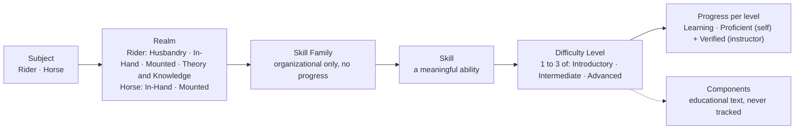
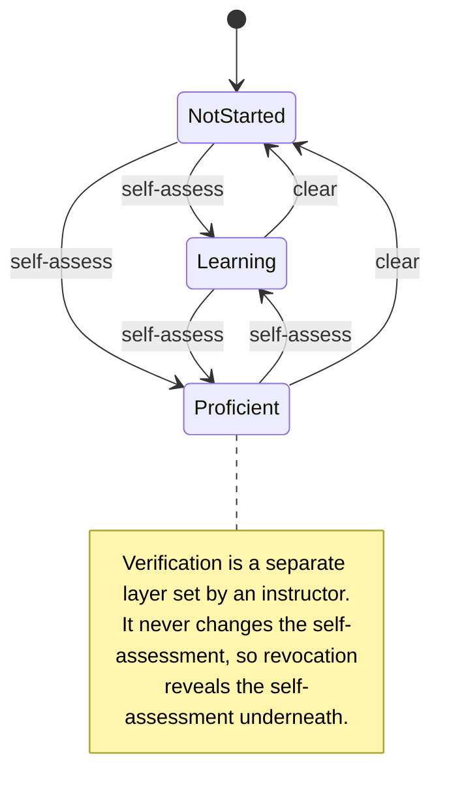
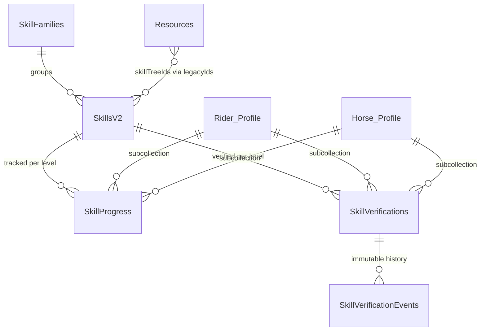

# Skill Tree 2.0 — Architecture & Curriculum Redesign Proposal

> [!NOTE]
> **Status:** Planning only. Nothing has been written to production Firestore, Flutter code, rules, or user progress. Batch 0E is still unpublished; its material is used below only as source content.
> **Supersedes (once approved):** the per-skill structure in [skill_tree_curriculum_proposal.md](file:///home/matteo/.gemini/antigravity/brain/9959963d-cf2a-4c61-946a-61af8edc96d7/skill_tree_curriculum_proposal.md). The approved principles carry forward: technique neutrality, independent Rider and Horse progress, difficulty definitions, `Other` displayed as Theory & Knowledge, Rider-only Husbandry, and the UX decisions in [skill_tree_ux_redesign_proposal.md](file:///home/matteo/.gemini/antigravity/brain/9959963d-cf2a-4c61-946a-61af8edc96d7/skill_tree_ux_redesign_proposal.md).

**Guiding principle:** *Track meaningful abilities at progressive levels. Describe component tasks for education, but do not require separate progress assessments for each component.*

**Headline result:** the 84 current skill records become **58 skills** with **98 level standards**. There is also **1 proposed new skill** (Horse Ground Driving), included only because it is a requested example. Every old ID is accounted for.

---

## 0. Audit Findings That Shape This Design

| Area | What exists today | Implication for 2.0 |
|---|---|---|
| Skill model | [skill.dart](file:///home/matteo/Pictures/Projects/Horse-and-Rider-s-Companion/packages/database_repository/lib/src/models/skill.dart): one `difficulty`, one `learningDescription` / `proficientDescription`, `prerequisites`, `category`, `rider`. `fromMap` hard-casts `id`, `rider`, `position`, `skillName`. | Has no room for multiple levels. Older app builds would crash or show wrong content if the `Skills` documents were restructured in place, so v2 should use a **new collection**. |
| Fields published in Batches 0A–0D | `skillFamily`, `aliases`, `complementarySkillId` exist in Firestore, but **no Dart code reads them**. `skillFamily` values use mixed formats (`daily_grooming_and_hoof_care` vs. "Navigation & Pattern Obstacles" in Batch 0E). | Do **not** reuse free-text `skillFamily`. Replace it with a `familyId` that points to a `SkillFamilies` document. |
| Progress storage | An embedded array `skillLevels: [{skillId, skillName, levelState, verified, lastEditBy, lastEditDate}]` on `Rider_Profile` and `Horse_Profile`, written by the client ([app_cubit.dart](file:///home/matteo/Pictures/Projects/Horse-and-Rider-s-Companion/lib/App/Cubit/app_cubit.dart#L489-L517)). | One state per skill means levels can't be stored. Move to per-skill, per-level documents. |
| Verification | Callable `coachingConnection` → `addRecord` ([connections.js](file:///home/matteo/Pictures/Projects/Horse-and-Rider-s-Companion/functions/connections.js#L815-L893)). Instructors can verify `LEARNING` or `PROFICIENT`. Only the instructor who verified can remove it. Audit is a profile note or `SharedRidingEntries` journal entry. | Keep this callable path and its idempotent `recordId`. Add a level, any-active-instructor revocation (already approved), and immutable events. |
| **Security gap 1** | `Rider_Profile` and `Horse_Profile` rules let the owner update any field except a few protected keys. The owner can write `verified: true` into their own `skillLevels`. | In v2, verifications live in **documents only Cloud Functions can write**. |
| **Security gap 2** | The catch-all rule lets **any signed-in user write** `Skills`, `Resources`, `Levels`, etc. The in-app skill editor is gated only by `RiderProfile.editor`, a field owners can set on themselves. | `SkillsV2` and `SkillFamilies` should be written by the Admin SDK only. The `editor` flag needs a custom claim (fix separately, with approval). |
| Resources | `Resource.skillTreeIds: List<String>`. Read-only census: 17 resources, 14 linked, 32 links. | Resolve links through each v2 skill's `legacyIds`. **No Resource documents need to change.** |
| Test progress (read-only census) | Riders: 13 profiles, 4 with progress, 28 entries (22 Proficient, 6 Learning), 3 verified, 2 orphaned. Horses: 6 profiles, 3 with progress, 20 entries, 2 verified, **17 orphaned** (pointing at skill IDs that no longer exist). | The volume is small and partly broken already, which makes a deliberate reset cheap (see F.4). |
| Legacy `Levels` collection / `Level` model | An older per-skill level concept (`levelName`, `completeDescription`). I did not inspect its production contents. | Leave untouched. Not reused, because it has no difficulty semantics and needs joins. |
| No forced update | No minimum-version gate in the app. | Old builds will keep reading legacy `Skills` / `skillLevels`. Freeze those collections instead of mutating them. |

---

## A. Architecture Proposal

### A.1 Hierarchy



| Layer | Purpose | Progress? |
|---|---|---|
| Subject / Realm | Navigation. Realm = existing `SkillCategory` enum (`Other` shown as "Theory & Knowledge"). | No |
| Skill Family | Browsing and discovery. No percentages, no required order, no completion. | **No** |
| Skill | One meaningful ability ("Can this rider groom?"). Canonical ID, aliases, links, resources. | No (container) |
| Difficulty Level | A progressively more demanding performance standard within the skill. Only meaningful levels exist. | **Yes**, the only tracked unit |
| Component | A named sub-task or knowledge item inside a level ("Cleaning hooves"). Searchable and educational. | No |

### A.2 Difficulty definitions (unchanged, now applied per level)
- **Introductory:** basic understanding and safe, functional execution. Polish not required.
- **Intermediate:** greater precision, consistency, balance, timing, and refinement.
- **Advanced:** technically complex work requiring sophisticated coordination, strength, or collection.

A skill offers 1, 2, or 3 levels. **A level exists only if its observable criteria differ from the level below in substance, not just in adjectives.** Skills may start at any level (Travers starts and ends at Advanced).

### A.3 Progress model per level



**Behavior rules**
1. **Levels are independent.** Changing one level never promotes, demotes, verifies, or fills in another. Users may assess levels in any order.
2. **Self-assessment** (Learning / Proficient / clear) is written by the rider for themselves, or by the current owner for a horse.
3. **Verification** is written only by the backend at an active instructor's request, for one specific `(skill, level)`. It records verifier, date, connection, and the `standardVersion` assessed. Recommended default: **verification confirms Proficient** (see G.2).
4. **Display:** if verified, the level shows "✓ Verified Proficient · Coach X · date". If the learner's own self-assessment differs, it is shown alongside ("You currently rate yourself: Learning").
5. **Re-verification** by another instructor replaces the *current* verification. The previous one stays in the event history.
6. **Revocation:** any instructor with an **accepted** connection may revoke (previously approved). An optional reason is recorded. The self-assessment is preserved, and an immutable event logs who originally verified and when.
7. **Learners cannot delete verifications.** They can change their self-assessment freely. Account deletion removes everything, as it does today.
8. **Standard changes:** a material rewrite of a level's criteria increments `standardVersion`. Existing verifications stay valid and are labelled "verified under an earlier standard (date)". Nothing is revoked automatically.
9. **Retired skills or levels:** progress is kept and hidden. If there is a replacement skill, its page points to it.
10. **Summaries are derived, not stored.** "Highest Proficient level" and "Highest Verified level" are computed for display and filtering.

### A.4 Independent Rider and Horse development
- Progress lives under each subject's own profile document. A rider skill and a horse skill **never share a progress record**.
- Links are made at the skill level: `relatedSkills: [{skillId, relation: "counterpart"}]`, symmetric, subject-crossing. **Levels do not need to match.** Example: Horse Ground Driving offers Introductory and Intermediate, while Rider Ground Driving offers Intermediate and Advanced.
- Other relation types: `foundation` (soft "builds on", optionally at a level), `next` (suggested exploration), `theory` (Theory & Knowledge link). **None of them block access.** Prerequisites become suggestions.

### A.5 Components vs. skills: decision criteria

Apply these tests in order:

| # | Test | If yes → |
|---|---|---|
| 1 | Is it a step, tool, or sub-task that is normally performed as part of a broader ability, and would assessing it separately rarely change a trainer's judgment? (hoof picking within grooming; checking girth within tack) | **Component** in the relevant level |
| 2 | Is it the same ability applied to a different gait, pattern, object, or context? (slalom vs. figure-eight vs. cloverleaf; sidepass over a rail; bridge vs. tarp) | **Variation/application**: an example in a level, or the axis that separates levels (walk → trot → canter) |
| 3 | Can the higher standard be reached by **refining** the same ability (precision, consistency, harder contexts)? | **Another level** of the same skill |
| 4 | Does it need **new biomechanics, coordination, or safety knowledge** not implied by an existing skill? (Travers vs. Shoulder-In; half-pass; pirouettes; flying changes) | **Separate skill**, often Advanced |
| 5 | Would a trainer, buyer, or instructor reasonably ask "can they do X?" as a standalone question, and would it mean something on a profile? | Required for any **trackable skill** |

Two further rules:
- **Doing vs. teaching.** Rider skills describe handling or riding a *reasonably prepared* horse. Teaching a horse a behavior it lacks is a different competency and must not be folded silently into a level.
- **No padding.** If no meaningful Advanced (or Introductory) standard exists, the level is left out.

---

## B. Recommended Firestore Schema

New collections are **additive**. Legacy `Skills` and `skillLevels` remain untouched and frozen, which keeps rollback simple.



### B.1 `SkillFamilies/{familyId}` (read: all · write: Admin SDK only)
```json
{
  "id": "rider.mounted.lateral_movements",          // string
  "subject": "rider",                                // "rider" | "horse"
  "realm": "Mounted",                                // "Husbandry" | "In_Hand" | "Mounted" | "Other"
  "name": "Lateral Movements",                       // string
  "description": "Moving forward and sideways along a line with controlled bend and alignment.",
  "sortOrder": 50,                                   // int
  "schemaVersion": 2                                 // int
}
```
*There are deliberately no progress, count, or completion fields.*

### B.2 `SkillsV2/{skillId}` (read: all · write: Admin SDK only)
```json
{
  "id": "rider.mounted.shoulder_in",                 // string == doc ID, stable forever
  "schemaVersion": 2,                                // int
  "status": "active",                                // "draft" | "active" | "retired"
  "subject": "rider",                                // string
  "realm": "Mounted",                                // string (existing enum names)
  "familyId": "rider.mounted.lateral_movements",     // string → SkillFamilies
  "name": "Shoulder-In",                             // string
  "aliases": ["Shoulder in", "Épaule en dedans", "Shoulder-fore"],   // string[]
  "summary": "What the skill is…",                   // string
  "purpose": "Why it is useful…",                    // string
  "safety": ["…"],                                   // string[]
  "availableLevels": ["intermediate", "advanced"],   // ordered string[] (1–3)
  "levels": {                                        // map keyed by level
    "intermediate": {
      "overview": "…",                               // string
      "components": [                                // {title, description}[] (educational only)
        {"title": "Establishing bend", "description": "…"}
      ],
      "learning": "…",                               // string
      "proficient": "…",                             // string
      "standardVersion": 1,                          // int
      "standardUpdatedAt": "<timestamp>"             // timestamp
    },
    "advanced": { "...": "same shape" }
  },
  "relatedSkills": [                                 // {skillId, relation, level?}[]
    {"skillId": "horse.mounted.shoulder_in", "relation": "counterpart"},
    {"skillId": "rider.mounted.leg_yield", "relation": "foundation", "level": "intermediate"},
    {"skillId": "rider.mounted.travers", "relation": "next"}
  ],
  "legacyIds": ["rider.mounted.shoulder_in"],        // string[]: old Skills IDs this replaces
  "sortOrder": 20,                                   // int within family
  "replacedBy": null,                                // string | null (when retired)
  "updatedAt": "<timestamp>",
  "updatedBy": "curriculum-publisher"                // string
}
```
*Search index = `name` + `aliases` + component `title`s. Searching "hoof picking" finds Grooming, labelled "Included in Grooming · Introductory".*

### B.3 `{Rider_Profile|Horse_Profile}/{profileId}/SkillProgress/{skillId}` (self-assessment)
Writable by the rider (their own profile) or the horse's `currentOwnerId`. Rules validate keys and values.
```json
{
  "skillId": "rider.mounted.shoulder_in",            // string == doc ID
  "subject": "rider",                                // string
  "levels": {
    "intermediate": {
      "state": "PROFICIENT",                         // "LEARNING" | "PROFICIENT"
      "updatedAt": "<timestamp>",
      "updatedBy": "rider@example.com"               // string (lower-cased email)
    },
    "advanced": {"state": "LEARNING", "updatedAt": "<timestamp>", "updatedBy": "rider@example.com"}
  },
  "updatedAt": "<timestamp>",
  "schemaVersion": 2
}
```
Clearing a level deletes its map key. A document with no levels is deleted.

### B.4 `{…}/SkillVerifications/{skillId}` (current verification) · **client writes denied**
```json
{
  "skillId": "rider.mounted.shoulder_in",
  "levels": {
    "intermediate": {
      "verifiedState": "PROFICIENT",                 // string
      "verifiedBy": "coach@example.com",             // string
      "verifiedByName": "Elena Rostova",             // string
      "verifiedAt": "<timestamp>",                   // server timestamp
      "connectionId": "abc123",                      // string
      "standardVersion": 1,                          // int
      "eventId": "verification-abc123-…"             // string → event doc
    }
  },
  "updatedAt": "<timestamp>"
}
```

### B.5 `{…}/SkillVerificationEvents/{eventId}` (immutable audit) · **client writes denied**
```json
{
  "type": "revoked",                                 // "verified" | "revoked"
  "skillId": "rider.mounted.shoulder_in",
  "skillName": "Shoulder-In",                        // snapshot at time of event
  "level": "intermediate",
  "verifiedState": "PROFICIENT",
  "actorEmail": "coach2@example.com",
  "actorName": "Sam Lee",
  "connectionId": "def456",
  "previousVerification": {"verifiedBy": "coach@example.com", "verifiedAt": "<timestamp>"},
  "reason": "Re-assessed after lameness layoff",     // string | null (≤ 1000 chars)
  "standardVersion": 1,
  "at": "<server timestamp>"
}
```
The existing coach note / `SharedRidingEntries` journal entry continues to be written alongside, so the logbooks keep working.

### B.6 Resources
- No schema change is needed at launch. The skill page queries `Resources where skillTreeIds array-contains-any [skill.id, ...skill.legacyIds]` (≤ 30 values).
- Optional later: `skillLinks: [{skillId, levels: ["introductory"]}]` on **new** resources, so they can be filtered by level. The approved helpfulness ranking (with vote-count weighting and unrated resources still discoverable) is unchanged.

### B.7 Dart (planned, not written)
New classes: `CurriculumSkill`, `SkillLevelDefinition`, `SkillComponent`, `SkillFamily`, `RelatedSkill`, `SkillProgressRecord`, `LevelProgress`, `LevelVerification`, `VerificationEvent`. They map `realm` onto the existing `SkillCategory` and level keys onto the existing `DifficultyState`. Legacy `Skill` and `SkillLevel` stay until cleanup.

---

## C. Existing-to-New Curriculum Mapping

**Legend:** **R** = retained (same ID) · **RN** = renamed or re-IDed (1:1) · **M** = merged · **C** = converted to a component or application · ★ = new level proposed (needs trainer approval, G.4).
*Level mapping* shows where an old skill's content lands. It is also the mapping the optional migration in F.4 would use.

### C.1 Rider → Husbandry (15 → 10 skills)
| Family | New skill (canonical ID) | Levels | Old ID → new level (action) |
|---|---|---|---|
| Safety & Handling | Safe Handling & Restraint (`rider.husbandry.safe_handling`) | Intro · Int★ | `approach_safely` → Intro (M) · `tie_safely` → Intro component (C) |
| Daily Care & Grooming | Grooming (`rider.husbandry.grooming`) | Intro · Int★ | `grooming_basics` → Intro (M) · `pick_hooves` → Intro component (C) · `bathing_basics` → Int component (C) |
| Daily Care & Grooming | Blanketing (`rider.husbandry.blanketing`) | Intro · Int★ | `blanketing_basics` → Intro (RN) |
| Health & First Aid | Health Monitoring (`rider.husbandry.health_monitoring`) | Intro · Int | `basic_health_check` → Intro (M) · `vital_signs` → Int component (C) |
| Health & First Aid | First Aid (`rider.husbandry.first_aid`) | Int | `basic_first_aid` → Int (RN) |
| Health & First Aid | Administering Medications (`rider.husbandry.medications`) | Int | `oral_medication` → Int (RN; already broadened in 0A) |
| Health & First Aid | Leg Wraps & Bandaging (`rider.husbandry.leg_wraps`) | Int | `leg_bandaging_basics` → Int (RN) |
| Feeding & Stable Management | Feeding (`rider.husbandry.feeding`) | Intro · Int★ | `feeding_basics` → Intro (RN) |
| Feeding & Stable Management | Stable Care (`rider.husbandry.stable_care`) | Intro | `stall_cleaning_basics` → Intro (RN) |
| Tack & Equipment | Tack Use, Fit & Care (`rider.husbandry.tack`) | Intro · Int★ | `tack_check_and_fit` → Intro (M) · `clean_tack_and_equipment` → Intro component (C) |

*Gap found:* the current curriculum has **no rider "tack up / untack" skill**. Recommendation: include it as an Introductory component of Tack Use, Fit & Care rather than creating a new skill.

### C.2 Rider → In-Hand (15 → 9 skills)
| Family | New skill | Levels | Old ID → new level |
|---|---|---|---|
| Haltering & Leading | Catching, Haltering & Turnout (`rider.in_hand.catch_halter_turnout`) | Intro · Int★ | `catch_and_halter` → Intro (M) · `turn_out` → Intro (M) |
| Haltering & Leading | Leading (`rider.in_hand.leading`) | Intro · Int | `lead_walk`, `lead_trot` → Intro (M) · `back_up` → Intro component (C) · `present_inspection` → Int application (C) |
| Ground Control & Yielding | Turn on the Forehand (In-Hand) (`rider.in_hand.turn_on_forehand`) | Intro · Int★ | `yield_hindquarters` → Intro (RN; keeps 0C aliases) |
| Ground Control & Yielding | Yield the Forequarters (In-Hand) (`rider.in_hand.yield_forequarters`) | Int | R |
| Ground Control & Yielding | Sidepass (In-Hand) (`rider.in_hand.sidepass_in_hand`) | Int | R |
| Longeing & Long-Lining | Longeing (`rider.in_hand.longeing`) | Int · Adv★ | `lunge_walk_trot`, `lunge_canter` → Int (M; gaits become components) |
| Longeing & Long-Lining | Ground Driving (`rider.in_hand.ground_driving`) | Int · Adv★ | R → Int |
| Obstacles, Outings & Travel | In-Hand Obstacles & Outings (`rider.in_hand.obstacles_outings`) | Intro★ · Int | `obstacles_in_hand`, `hand_walk_trail` → Int (M) |
| Obstacles, Outings & Travel | Trailer Loading (`rider.in_hand.trailer_loading`) | Int | R |

### C.3 Rider → Mounted (22 → 17 skills)
**Family review of the six proposed families:**
- *Pivoting & Body-Part Control* and *Lateral Movement* overlap (sidepass and leg yield both move sideways). **Proposed boundary:** *Lateral Movements* = moving **forward and sideways** along a line. *Pivots & Body Control* = stationary, backward, or purely sideways repositioning (turns on forehand/haunches, rein back, sidepass).
- *Terrain & Surface Negotiation* → **Terrain & Obstacles** (plainer wording; covers poles, bridges, tarps, water, banks, hills).
- *Mounted Object Interaction* → **Object Handling** (gates, carrying or moving objects).
- **Gap:** Mounting, rider position, and safety skills had no home. Proposed 7th family: **Position, Balance & Safety** (G.6).
- Bend appears in both Steering and Lateral, and the half-halt cuts across families. This is acceptable because families are for browsing only.

| Family | New skill | Levels | Old ID → new level |
|---|---|---|---|
| Position, Balance & Safety | Mounting & Dismounting (`rider.mounted.mounting`) | Intro | R |
| Gaits, Rhythm & Transitions | Walk (`rider.mounted.walk`) | Intro · Int★ | R → Intro |
| Gaits, Rhythm & Transitions | Trot (`rider.mounted.trot`) | Intro · Int★ | R → Intro |
| Gaits, Rhythm & Transitions | Canter (`rider.mounted.canter`) | Intro · Int | R → Intro. Leads and balanced circles = Int (the earlier "separate Intermediate milestone" becomes a level). |
| Gaits, Rhythm & Transitions | Transitions (`rider.mounted.transitions`) | Int · Adv★ | `upward_transitions`, `downward_transitions` → Int (M) · `halt_on_mark` → Int application (C). Adv = direct and within-gait transitions. |
| Gaits, Rhythm & Transitions | Half-Halt (Rebalancing) (`rider.mounted.half_halt`) | Int | R |
| Steering, Bend & Direction Changes | Steering & Arena Figures (`rider.mounted.steering_figures`) | Intro · Int★ | `straight_line`, `circle_20m` → Intro (M) |
| Steering, Bend & Direction Changes | Navigation Patterns (`rider.mounted.navigation_patterns`) | Intro★ · Int · Adv★ | `slalom` → Int (C: slalom becomes one example pattern) |
| Pivots & Body Control | Turn on the Forehand (`rider.mounted.turn_on_forehand`) | Intro · Int★ | R → Intro |
| Pivots & Body Control | Turn on the Haunches (`rider.mounted.turn_on_haunches`) | Int | R |
| Pivots & Body Control | Rein Back (`rider.mounted.rein_back`) | Int · Adv★ | R → Int · `back_through_L` → Int application (C) |
| Pivots & Body Control | Sidepass (`rider.mounted.sidepass`) | Int | `sidepass_rail` → Int (RN; "over a rail" becomes an application) |
| Lateral Movements | Leg Yield (`rider.mounted.leg_yield`) | Int | R |
| Lateral Movements | Shoulder-In (`rider.mounted.shoulder_in`) | Int★ · Adv | R → Int (old criteria "at walk or trot" match the new Int) |
| Lateral Movements | Travers (Haunches-In) (`rider.mounted.travers`) | Adv | `haunches_in` → Adv (RN; Batch 0E inward-bend correction kept) |
| Terrain & Obstacles | Obstacles & Terrain (`rider.mounted.obstacles_terrain`) | Intro · Int | `bridge_obstacle` → Intro (M) · `water_obstacle` → Int (M). This resolves Batch 0E open question 1. |
| Object Handling | Object Handling (`rider.mounted.object_handling`) | Int | `gate_obstacle` → Int (RN; scope broadened, G.5) |

*Not created (future candidates only, flagged rather than drafted):* Half-Pass, Renvers, Pirouettes, Flying Changes, Counter-Canter, Jumping, Emergency Skills. Per test #4 these would be separate skills.

### C.4 Rider → Theory & Knowledge (stored `Other`; 0 existing skills)
Families: **How Horses Learn** · **Behavior & Body Language** · **Movement & Training Principles** · **Welfare, Ethics & Ownership**.
*Recommendation:* when authored, the ~22 module items from the earlier proposal should collapse into roughly **6–10 multi-level skills** (for example, one "Learning Theory" skill with Intro/Int/Adv levels instead of 8 separate skills). None are drafted here.

### C.5 Horse → In-Hand (10 → 6 skills, + 1 proposed new)
| Family | New skill | Levels | Old ID → new level |
|---|---|---|---|
| Leading & Ground Manners | Leading & Halter Response (`horse.in_hand.leading`) | Intro · Int★ | `lead_politely` → Intro (M) · `yield_to_halter` → Intro component (C) |
| Leading & Ground Manners | Standing Quietly (`horse.in_hand.standing_quietly`) | Intro · Int★ · Adv | `stand_tied` → Intro (M) · `ground_tie_horse` → Adv (M) |
| Cooperative Care | Daily Care Handling (`horse.in_hand.daily_care_handling`) | Intro · Int★ | `stand_for_saddling`, `stand_for_blanketing`, `stand_for_bathing` → Intro (M) |
| Cooperative Care | Hoof Handling (`horse.in_hand.hoof_handling`) | Intro · Int★ | R → Intro. Int = calm for the farrier. |
| Cooperative Care | Veterinary & Medical Handling (`horse.in_hand.vet_handling`) | Int | `stand_for_vet` → Int (RN) |
| Travel & New Environments | Trailer Loading (`horse.in_hand.trailer_loading`) | Int | `load_trailer` → Int (RN) |
| Work on the Line | **Ground Driving** (`horse.in_hand.ground_driving`) | Intro · Int | **Proposed new.** Implements the Batch 0C note (Basic Ground Driving at Introductory). |

### C.6 Horse → Mounted (22 → 16 skills)
Uses the same family names as Rider → Mounted, so counterpart pairs appear in the same place. *Position, Balance & Safety* becomes **Standing & Mounting Manners** for horses.

| Family | New skill | Levels | Old ID → new level |
|---|---|---|---|
| Standing & Mounting Manners | Standing Under Saddle (`horse.mounted.standing`) | Intro · Int★ | `stand_halt` → Intro (RN) |
| Gaits, Rhythm & Transitions | Walk / Trot / Canter Under Saddle (`horse.mounted.walk`, `.trot`, `.canter`) | Intro · Int★ (canter Int = leads and balance) | `walk_under_saddle`, `trot_under_saddle`, `canter_under_saddle` → Intro (RN) |
| Gaits, Rhythm & Transitions | Transitions (`horse.mounted.transitions`) | Intro · Int · Adv★ | `halt_under_saddle` → Intro (M) · `upward_…`, `downward_transitions_horse` → Int (M) · `respond_half_halt` → Int component (C) |
| Steering, Bend & Direction Changes | Straightness, Bend & Steering (`horse.mounted.straightness_steering`) | Intro · Int★ | `straight_under_saddle`, `circle_balance` → Intro (M) |
| Steering, Bend & Direction Changes | Navigation Patterns (`horse.mounted.navigation_patterns`) | Intro★ · Int · Adv★ | `slalom_horse` → Int (C) |
| Pivots & Body Control | Turn on the Forehand (`horse.mounted.turn_on_forehand`) | Intro · Int★ | R → Intro |
| Pivots & Body Control | Turn on the Haunches (`horse.mounted.turn_on_haunches`) | Int | R |
| Pivots & Body Control | Rein Back (`horse.mounted.rein_back`) | Int | `rein_back_horse` → Int (M) · `back_L_horse` → Int application (C) |
| Pivots & Body Control | Sidepass (`horse.mounted.sidepass`) | Int | `sidepass_horse` → Int (RN) |
| Lateral Movements | Leg Yield (`horse.mounted.leg_yield`) | Int | `leg_yield_horse` (RN) |
| Lateral Movements | Shoulder-In (`horse.mounted.shoulder_in`) | Int★ · Adv | `shoulder_in_horse` → Int (RN) |
| Lateral Movements | Travers (`horse.mounted.travers`) | Adv | `haunches_in_horse` (RN) |
| Terrain & Obstacles | Obstacles & Terrain (`horse.mounted.obstacles_terrain`) | Intro · Int | `bridge_horse` → Intro (M) · `water_horse` → Int (M) |
| Object Handling | Object Handling (`horse.mounted.object_handling`) | Int | `gate_horse` → Int (RN) |

### C.7 Totals
| Realm | Old skills | New skills | Level standards |
|---|---|---|---|
| Rider Husbandry | 15 | 10 | 16 |
| Rider In-Hand | 15 | 9 | 15 |
| Rider Mounted | 22 | 17 | 28 |
| Horse In-Hand | 10 | 6 (+1 new) | 11 (+2) |
| Horse Mounted | 22 | 16 | 28 |
| **Total** | **84** | **58 (+1)** | **98 (+2)** |

No old record is simply deleted. Every old ID appears in exactly one `legacyIds` array, so Resource links and history still resolve. Legacy `prerequisites` are replaced by a much smaller set of non-blocking `foundation` links.

---

## D. Representative Skill Examples

### D.1 Rider → Husbandry → Daily Care & Grooming → **Grooming**
**What it is:** Keeping a horse's coat, skin, mane, tail, and hooves clean and healthy, and using grooming time to notice changes in the horse's condition.
**Why it matters:** Grooming is the most frequent hands-on contact with a horse. It builds handling confidence and is often the first place problems are noticed.
**Safety:** Work from safe positions with awareness of the horse's body language. Restrain the horse appropriately. Take care around sensitive areas. Watch for slippery wash areas, chilling after bathing, and product sensitivities.
*Aliases:* Brushing, Hoof picking, Daily grooming, Mane and tail care. *Legacy:* `grooming_basics`, `pick_hooves`, `bathing_basics`.

| | **Introductory** | **Intermediate** |
|---|---|---|
| Components | Routine grooming of body, legs, mane and tail · Cleaning all four hooves · Checking for obvious problems (cuts, swelling, heat, loose or missing shoe, hoof odor) · Cleaning and storing grooming tools · Basic hygiene between horses | Bathing and drying suited to the weather · Seasonal coat care (shedding, winter coat, mud and rain) · Mane and tail care without damage · Recognizing subtler changes (early skin conditions, mild filling or heat, hoof changes, condition changes) · Adapting to the individual horse's sensitivities |
| **Learning** | Grooms with guidance. May miss areas or need reminders about positioning. Picks up and cleans hooves on a cooperative horse with help. | Bathes and does seasonal care with guidance. Starting to notice subtle changes but needs confirmation. |
| **Proficient** | Independently and safely grooms a cooperative horse thoroughly, cleans all four hooves, keeps a safe position, and notices and reports obvious problems. | Independently plans and carries out grooming suited to the season, weather, and horse, including bathing and drying safely. Recognizes subtle changes and knows when to monitor, adjust care, or seek professional advice. |

*No Advanced level.* Show turnout or clipping could become separate skills later if trainers want them tracked.

### D.2 Rider → Mounted → Lateral Movements → **Shoulder-In**
**What it is:** The horse's shoulders are brought slightly in from the track while the hindquarters stay on it. The horse keeps a slight, even bend away from the direction of travel and moves forward along the line (commonly on three tracks; traditions differ on the exact angle).
**Why it matters:** It develops straightness, suppleness, and engagement of the inside hind leg, and it is a foundation for more advanced lateral work.
**Safety:** Build up from shallow angles and short sections. Never force bend with the reins or ask for angles the horse cannot yet sustain.
*Aliases:* Shoulder-fore (early form), Épaule en dedans. *Counterpart:* `horse.mounted.shoulder_in`. *Foundation:* Leg Yield (Int). *Next:* Travers.
Technique-neutral: no particular aids are prescribed. Resources present different methods.

| | **Intermediate** | **Advanced** |
|---|---|---|
| Components | Establishing bend before the movement · Shoulder-fore as an entry point · Keeping the line of travel · Returning to straight | Sustaining the angle along a full long side · Transitions in and out · Riding it out of figures and into other movements |
| **Learning** | Positions the shoulders in for a few strides at walk. Angle, bend, or rhythm are inconsistent. | Sustains shoulder-in at trot with occasional loss of angle, bend, or impulsion. |
| **Proficient** | Rides a recognizable shoulder-fore or shoulder-in at walk and for short trot sections, in both directions. The horse moves forward along the line without drifting and returns smoothly to straight. Small variations in angle are acceptable. | Sustains shoulder-in at trot along a full long side in both directions with consistent angle and bend, steady rhythm and impulsion, and a relaxed horse. Enters and exits cleanly and connects it to other figures and movements. |

### D.3 Rider → Mounted → Steering, Bend & Direction Changes → **Navigation Patterns**
**What it is:** Riding a planned route around markers or obstacles: slaloms, figure-eights around markers, cloverleaf patterns, serpentines through cones, trail-course routes.
**Why it matters:** It trains planning ahead, timely preparation, and smooth changes of direction and bend. These are useful across ranch, trail, games, working equitation, and arena riding.
**Safety:** Choose markers safe for horses and good footing. Space markers to suit the gait and the horse's stride. Speed should never exceed the rider's control, and competition speed is never required.
*Aliases:* Slalom, Pole bending (pattern), Cone patterns, Cloverleaf, Figure-eight. *Legacy:* `slalom`. *Counterpart:* `horse.mounted.navigation_patterns`.

| | **Introductory** | **Intermediate** | **Advanced** |
|---|---|---|---|
| Focus | Walk | Trot | Canter |
| **Learning** | Follows a simple pattern at walk with help. Turns may be wide or late. | Rides patterns at trot. Bend changes may be late, tempo may vary, or markers are occasionally missed. | Rides patterns at canter. Balance, speed, or lead management is inconsistent. |
| **Proficient** | Independently rides simple marker patterns at walk. Plans the route ahead, passes each marker on the correct side, and keeps a steady walk and safe spacing. | Rides varied patterns at trot with consistent rhythm, well-prepared and accurate turns, and smooth changes of direction and bend, without unintended breaks of gait or knocked markers. | Rides complex patterns at canter with balance and control of speed. The horse is on an appropriate lead for each turn (or a deliberately chosen counter-lead), with lead changes planned using a method suited to the horse's training. Turns are balanced, not rushed. |

*Flying changes are not required.* They would be a separate skill.

### D.4 Rider → In-Hand → Longeing & Long-Lining → **Ground Driving**
**What it is:** Directing a horse from on foot, from behind or behind-and-to-the-side, using two long lines.
**Why it matters:** It builds forward movement, steering, and confidence without a rider. Ground driving is used to prepare horses for riding or driving, to add variety, and to work on straightness.
**Safety:** Never wrap lines around hands or body. Stay clear of kicking range and of the lines. Start in an enclosed area. The horse must accept lines touching its legs and hindquarters. Have a plan if the horse bolts or the lines tangle. A helper is advisable in early sessions.
*Legacy:* `rider.in_hand.ground_driving` (approved Intermediate in 0C). *Counterpart:* `horse.in_hand.ground_driving` (levels differ by design). Equipment arrangements vary by tradition, and Resources cover them.

| | **Intermediate** | **Advanced** ★ |
|---|---|---|
| Components | Equipment selection and fit · Organizing and handling two lines · Safe position and distance · Starting, stopping, turning · Responding to spooks or crossed lines | Steady, consistent contact · Accurate figures and transitions · Trot work (often on large figures or circles) · Working outside the arena where appropriate · Using driving to support a training goal |
| **Learning** | Drives an experienced, quiet horse at walk in an enclosed area with guidance. Lines sometimes tangle and turns are imprecise. | Drives figures and transitions with intermittent loss of contact, accuracy, or positioning. |
| **Proficient** | Independently and safely ground drives an experienced horse at walk and halt in an enclosed area. Handles both lines without tangling, keeps a safe position, starts, stops and turns both ways, and responds calmly if the horse spooks or lines cross. | Drives at walk and trot with steady contact, accurate figures and transitions, and safe positioning throughout. Uses ground driving purposefully toward the horse's training goals and recognizes when to stop or seek help. |

### D.5 Horse → In-Hand → Work on the Line → **Ground Driving** (proposed new skill)
**What it is:** The horse's learned ability to move forward, stop, and turn in response to two long lines handled from behind or beside it.
**Safety:** The horse should accept lines along its body and legs before being driven. Early sessions need a handler who is proficient at Rider Ground Driving (Intermediate).
*Counterpart:* `rider.in_hand.ground_driving`. This pairing shows independence: a horse at **Introductory** can be developed by a rider proficient at **Intermediate**.

| | **Introductory** | **Intermediate** |
|---|---|---|
| **Learning** | Accepts the lines with some tension or hesitation. May need a helper at its head. Halts and turns are sometimes delayed. | Drives at trot or outside the arena with occasional rushing, bracing, or loss of straightness. |
| **Proficient** | Calmly accepts equipment and lines touching its body. Walks forward willingly, and halts and turns both ways in an enclosed area on light, steady requests, without bracing, rushing, or turning to face the handler. | Drives forward confidently at walk and trot with steady rhythm and straightness. Makes prompt transitions, follows figures and changes of direction, and stays calm in varied settings and if lines touch its legs unexpectedly. |

---

## E. UX & Trainer Profile Concepts

These keep the approved decisions: responsive layouts and the mobile editor, subject-specific realms (Horse shows only In-Hand and Mounted), unrestricted Horse browsing without a selected horse (a profile is requested only when recording progress), and no global completion percentages.

### E.1 Browse: Subject → Realm → Family → Skill (mobile)
```
┌──────────────────────────────────┐
│ [ Rider ]  Horse ▾ (optional)    │
│ Husbandry · In-Hand · Mounted · Theory │
├──────────────────────────────────┤
│ 🔍 Search skills, terms, tasks…  │
├──────────────────────────────────┤
│ LATERAL MOVEMENTS                │
│ Moving forward and sideways…     │
│  Leg Yield          Int    ● P   │
│  Shoulder-In        Int Adv ● L  │
│  Travers            Adv          │
├──────────────────────────────────┤
│ PIVOTS & BODY CONTROL        ›   │
│ STEERING, BEND & DIRECTION   ›   │
└──────────────────────────────────┘
```
- Family headers show a description only. **No counts of completion, no bars.**
- Skill rows show which levels exist (chips) and the user's own state at each, as small dots (L / P / ✓).
- Search covers names, aliases, and component titles ("hoof picking" → *Grooming · Introductory*).

### E.2 Skill detail with level explorer
```
┌──────────────────────────────────────────┐
│ Shoulder-In              Lateral Movements│
│ Also known as: Shoulder-fore, Épaule en…  │
│ What it is · Why it matters · Safety      │
├──────────────────────────────────────────┤
│ [ Intermediate ✓ ] [ Advanced ● Learning ]│
├──────────────────────────────────────────┤
│ INTERMEDIATE                              │
│ ▸ What this level includes (components)   │
│ Learning looks like…                      │
│ Proficient looks like…                    │
│ Your assessment: ( Learning )(Proficient●)│
│ ✓ Verified Proficient · E. Rostova · Oct 12│
│ ▸ Verification history                    │
├──────────────────────────────────────────┤
│ Resources for this skill  [Helpful ▾]     │
│ Related: 🐴 Horse counterpart · Builds on │
│          Leg Yield · Explore next: Travers│
└──────────────────────────────────────────┘
```
- One tab per **available** level only. Opening a level never changes progress.
- Self-assessment applies to the selected level only.
- Resources: level-tagged resources first, then general resources for the skill, using the approved helpfulness ranking.

### E.3 Rider or Horse profile: "Abilities" (positive, no percentages)
```
ABILITIES                         Filter: Verified · All
Mounted
  Canter ............ Intermediate ✓    Walk ...... Introductory P
  Shoulder-In ....... Intermediate P    Rein Back . Intermediate L
In-Hand
  Ground Driving .... Intermediate ✓
Recently developed: Leg Yield → Proficient (Int), 3 days ago
```
Each skill shows its **highest Proficient level**, with ✓ when that level is verified. Tapping it shows every level.

### E.4 Trainer review: Ability Matrix
```
Student: Sarah  ·  Realm: Mounted ▾  ·  Show: [Needs review] [Verified by me] [All with activity]
┌─────────────────────┬────────┬──────────────┬──────────┐
│ Skill               │ Intro  │ Intermediate │ Advanced │
├─────────────────────┼────────┼──────────────┼──────────┤
│ Canter              │ ✓ P    │ ● P  [Verify]│   —      │
│ Shoulder-In         │   —    │ ✓ P          │ ● L      │
│ Navigation Patterns │ ● P    │ ● L          │          │
└─────────────────────┴────────┴──────────────┴──────────┘
"—" = level not offered · blank = not assessed
```
- **Needs review** = levels the learner rated Proficient that are not verified, or that changed since last verified.
- Verify and revoke are per cell, with a confirmation dialog. The dialog shows the level's criteria, and on revocation it shows the original verifier plus an optional reason field.
- **Pair view** puts a rider and their horse side by side for counterpart skills (for example Rider Ground Driving Int vs. Horse Ground Driving Intro), which makes the independence visible.
- Works as a table on desktop and as a list of skill cards with level chips on mobile.

---

## F. Implementation & Migration Plan (after trainer approval)

| Stage | Work | Exit criteria / tests |
|---|---|---|
| **0. Freeze** | Stop publishing to legacy `Skills`. Batch 0E stays unpublished and is archived as source material. | Trainer approves A–E and the G decisions. |
| **1. Content as code** | Author `curriculum/v2/*.json` in the repo, plus a JSON Schema. Trainer reviews **per realm** (5 reviews instead of per-skill batches). | Validator reports 0 errors: unique IDs; valid family, subject, and realm; 1–3 ordered levels, each with `learning` and `proficient`; related skills resolve; counterparts cross subjects; **every one of the 84 legacy IDs appears exactly once**; no cycles in `foundation` links; technique-neutral lint warnings reviewed. |
| **2. Rules & backend (emulator)** | Rules for `SkillsV2`, `SkillFamilies` (client writes denied), `SkillProgress` (owner or horse-owner only, validated values), and `SkillVerifications` / `SkillVerificationEvents` (client writes denied). Callable actions `verifySkillLevel` / `revokeSkillLevel` in `coachingConnection`: idempotent `recordId`, level must exist on the skill, any accepted instructor may revoke, reason, event, `standardVersion`. | Rules tests: owner cannot write verifications; non-owner cannot self-assess; horse non-owner denied; malformed states rejected. Function tests: idempotency, inactive connection denied, unavailable level rejected, self-assessment preserved on revoke, events immutable. Existing rules and function test suites still pass. |
| **3. Flutter data layer** | New models and repositories behind a `skillTreeV2` feature flag. Legacy models untouched. | Unit tests: parsing (including missing or unknown fields), derived highest-Proficient and highest-Verified, legacy-ID resource resolution. |
| **4. UX behind the flag** | Browse, skill detail and level explorer, per-level self-assessment, profile Abilities, trainer matrix, pair view. | Widget tests and mobile/desktop screenshots; existing test suite green; `flutter analyze` clean. |
| **5. Backup → publish curriculum** | Timestamped, checksummed JSON export of `Skills`, all `Rider_Profile.skillLevels` / `Horse_Profile.skillLevels`, and `Resources.skillTreeIds`, plus a managed Firestore export if available. Publish `SkillFamilies` and `SkillsV2` with a create-only, idempotent script (fails if a document exists unless `--update`). | Script asserts the project ID, defaults to `--dry-run`, only touches allowlisted collections, compares pre-write against backup, verifies post-write by document count and content hash. No writes to profile documents, Resources, or media. |
| **6. Progress handling** | Per decision G.1. **Reset:** write nothing, so v2 progress simply starts empty and legacy `skillLevels` stay in place as an archive. **Migrate:** dry-run report per profile for trainer review, then create `SkillProgress` subcollection docs only. | Report reviewed; post-write verification; profile top-level documents unchanged (hash check). |
| **7. Cutover** | Release a build with the flag on. Add a small `AppConfig/minSupportedBuild` document so stale builds can be prompted to update. | Smoke tests on Android, iOS, and web. Monitor function errors. |
| **8. Cleanup (separate approval)** | Retire legacy `Skills` writes and the in-app legacy skill editor. Optionally remove `skillLevels` and canonicalize `Resources.skillTreeIds`. Fix the `editor` self-grant and catch-all write rules. | Separate review. |

### F.1 Rollback
Everything in v2 is **additive**: new collections and new subcollections. Legacy `Skills` and `skillLevels` are never modified before Stage 8. Rollback means turning the flag off or shipping the previous build. If needed, the v2 collections can be deleted by an allowlisted script, and backups support a full restore.

### F.2 Protections against unintended changes
Every script is dry-run by default, needs an explicit `--commit`, checks the project ID, uses a collection allowlist, diffs against backup before writing, and verifies after writing. There is no code path that writes `Rider_Profile` or `Horse_Profile` top-level fields, `Resources`, or Storage media. Flutter work happens on a branch, and `git status` is reviewed at each stage.

### F.3 Verification and logbook continuity
The v2 callable keeps writing the existing coach note / `SharedRidingEntries` journal entry, so logbooks stay unchanged. The new event documents add the per-level audit trail that was approved earlier.

### F.4 Migrate vs. reset existing test progress

| | **Deliberate reset + archive (recommended)** | **Conservative migration** |
|---|---|---|
| Effort and risk | Minimal. No profile writes at all. | Mapping script, dry-run report, trainer review, and writes to 7 profiles. |
| Accuracy | Clean slate under the new standards. | Merges are lossy. 19 of 48 entries are already orphaned, and several old skills map to only part of a new level. |
| Verifications | 5 legacy verifications stay readable in the archive and logbook notes. | Must **not** be carried as v2 verifications, because they attested different standards. They could only appear as "legacy verification" history notes. |
| User impact | 4 riders and 3 horse owners re-assess, a few minutes each. | Little re-entry, but some states may be misleading. |
| Rule if chosen | n/a | A level receives the **lowest** state among all old skills mapped to it. If only some mapped skills had progress, it receives Learning at most. Components never create progress on their own. Level elevations (old Intro → new Int) are never carried. |

---

## G. Decisions Requiring Trainer Input

1. **Existing test progress:** reset with an untouched archive (recommended), or conservative migration (F.4)?
2. **Verification scope:** should instructors verify **Proficient only** (recommended: "Verified" then means one clear thing), or also Learning, as the current backend allows?
3. **Steering & Arena Figures vs. Navigation Patterns:** keep both (recommended: geometry and bend in open space vs. route planning around markers), or merge them into one steering skill?
4. **Newly proposed levels (★ in section C):** approve them as a set, especially the two that start **below** a previously approved difficulty:
   - **Shoulder-In** gains an Intermediate level (shoulder-fore / walk and short trot), with established trot shoulder-in at Advanced.
   - **In-Hand Obstacles & Outings** gains an Introductory level (simple, familiar obstacles).
   - Other ★ levels (for example Longeing Advanced, Ground Driving Advanced, Rein Back Advanced, Transitions Advanced, Navigation Patterns Introductory and Advanced) only add depth above or alongside existing entry points.
5. **Broadened scopes:** Gate → **Object Handling** (gates plus carrying or moving objects), and **Tack Use, Fit & Care** including tacking up and untacking. Approve, or keep them narrow?
6. **Mounted families:** adopt the boundary rule (Lateral = forward-and-sideways; Pivots & Body Control = stationary, backward, or pure sideways) and add a 7th family, **Position, Balance & Safety** (Standing & Mounting Manners for horses)?
7. **Visibility:** profiles are publicly readable today, so skill progress and verifications are public. Keep that for v2, or limit detailed progress and verification history to the owner and connected instructors? (Recommended: public summary, private event history.)
